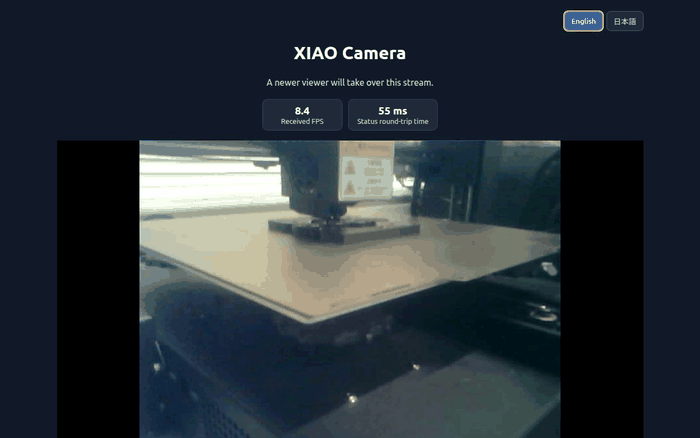

# XIAO ESP32-S3 Tailscale Camera

**日本語** | [English](README.md)

Seeed XIAO ESP32-S3 Sense用のカメラファームウェアです。初回設定とUSB書き込みにはDockerを使います。書き込み後はESP32本体だけで動作するため、映像を見るときにPCやDockerを起動しておく必要はありません。

## できること

- ブラウザーから最大10fpsのライブ映像を表示
- 新しい端末が開くと、その端末へ視聴を切り替え
- 自動露光、自動ゲイン、オートホワイトバランス
- Tailscale経由で外出先からアクセス
- 視聴画面に、受信FPSと通信応答時間を表示

暗所では露光補正を上げていますが、映像がザラついたり動くものがぼやけたりすることがあります。光がまったくない場所では照明が必要です。

## 用意するもの

- Seeed XIAO ESP32-S3 Sense（カメラ付き）とデータ通信対応USBケーブル
- 2.4GHz Wi-Fi
- DockerとDocker Composeが使えるLinux PC
- Tailscaleアカウント

## 初回設定

1. このリポジトリをダウンロードするか、クローンします。

   ```sh
   git clone https://github.com/HidemitsuNishioka/xiao-esp32s3-tailscale-camera.git
   cd xiao-esp32s3-tailscale-camera
   ```

2. 設定ファイルのひな形を複製します。

   ```sh
   cp .env.example .env
   cp secrets.yaml.example secrets.yaml
   ```

3. `secrets.yaml` をテキストエディターで開き、`REPLACE_ME` や `YOUR_...` の項目を自分の情報に置き換えます。
   - `wifi_ssid` と `wifi_password`: 2.4GHz Wi-Fiの情報
   - `tailscale_auth_key`: 次の「Tailscale認証キーとIPアドレス」の手順で作成します。キーは設定ファイルにだけ保存し、他人と共有しないでください。
   - `api_encryption_key`: ターミナルで `openssl rand -base64 32` を実行し、表示された文字列を設定します。
   - `web_username` と `web_password`: ESPHome状態ページ用に自分で決めます。

   `.env` と `secrets.yaml` はGitの対象外です。実際の認証情報をREADMEやソースコードへ書き込まないでください。

4. XIAOをUSB接続し、プロジェクトフォルダーで設定を確認してから書き込みます。

   ```sh
   docker compose run --rm esphome config xiao-esp32s3-tailscale-camera.yaml
   docker compose run --rm esphome run xiao-esp32s3-tailscale-camera.yaml --device /dev/ttyACM0
   ```

   書き込み後にESPHomeのログ画面が開いたままになることがあります。ログでWi-Fi/Tailscaleへの接続を確認したら `Ctrl+C` で閉じて構いません。ファームウェアはESP32上で動き続けます。

## Tailscale認証キーとIPアドレス

### 認証キーを作る

1. [Tailscale管理コンソールのKeysページ](https://login.tailscale.com/admin/settings/keys)を開きます。
2. **Generate auth key** を選び、カメラ1台だけを登録する場合は **Reusable** をオフにしてキーを作成します。**Ephemeral** もオフのままにします。
3. 表示されたキーを `secrets.yaml` の `tailscale_auth_key` に貼り付けます。キーはパスワードと同様に扱い、GitHubへ登録したり、READMEやスクリーンショットへ載せたりしないでください。
4. ファームウェアを書き込むと、ESP32がWi-Fi経由でTailnetに参加します。Tailnetで新しい端末の承認が必要な設定の場合は、管理コンソールで `xiao-camera` を承認します。

常設カメラとして長期間使う場合、Tailscale端末キーの期限が来ると再接続が必要になることがあります。必要なら[キー期限の説明](https://tailscale.com/docs/features/access-control/key-expiry)を確認し、Machinesページの `xiao-camera` のメニューから **Disable Key Expiry** を選べます。端末キーの期限を無効にすると再認証の手間が減りますが、端末を紛失した場合のリスクも考慮してください。

### カメラのIPアドレスを確認する

IPアドレスを自分で選んだり、`192.168...` のようなWi-Fi側のIPを入力したりする必要はありません。ESP32がTailnetに参加すると、Tailscaleがカメラに専用のIPアドレスを自動で割り当てます。通常は `100.x.y.z` の形式です（Tailscaleの範囲は `100.64.0.0`〜`100.127.255.255`）。

割り当てられたIPは[Tailscale管理コンソールのMachinesページ](https://login.tailscale.com/admin/machines)で `xiao-camera` を探して確認します。IPは端末がTailnetに登録されている間は通常変わらないため、その表示値を使います。詳しくは[TailscaleのIPアドレス説明](https://tailscale.com/docs/concepts/tailscale-ip-addresses)を参照してください。

## 映像を見る

見る側のスマートフォンやPCにもTailscaleを入れ、カメラと同じTailnetに接続します。ブラウザーで、管理コンソールに表示されたカメラのIPを次のURLに入れて開きます。

```text
http://<カメラのIPアドレス>:8082/
```

ブラウザーでは次のようにライブ映像が表示されます。



画面右上の **English** / **日本語** ボタンで表示言語を切り替えられます。

画面上部の **受信 FPS** は、カメラからブラウザーへ届いたフレームの更新速度です。**通信応答（往復）** は、ブラウザーとカメラの間で状態確認を往復させて測った時間です。これは映像の撮影から表示までの片道遅延そのものではありません。Wi-FiやTailnetの通信状況が悪いとFPSが下がったり、応答時間が長くなったりします。

ライブ映像は1端末ずつ視聴できます。後から接続した端末を優先し、前の端末には切断理由を表示します。

## Wi-Fiを変更する

ローカルの `secrets.yaml` にある `wifi_ssid` と `wifi_password` を変更し、XIAOをUSB接続して上記の書き込みコマンドを再実行します。Wi-Fiは2.4GHzに接続してください。

## 困ったとき

- **USBデバイスが見つからない:** データ通信対応ケーブルを使い、`.env` の `ESP32_DEVICE` をPC上のデバイス名に合わせます。初期値は `/dev/ttyACM0` です。
- **Wi-Fiにつながらない:** 2.4GHz対応のネットワークか、SSIDとパスワードに入力間違いがないかを確認します。
- **映像が開かない:** 閲覧端末も同じTailscaleネットワークに接続されているか、カメラのTailscale IPが正しいかを確認します。
- **暗所で見えにくい:** 周囲に照明を追加してください。暗いほどノイズや動きのぼやけが増えます。

## ポートとアクセス

- `8082`: ブラウザー向けライブ映像。Tailscale IPv4からの接続を受け付けます。
- `8081`: 静止画。ログイン認証はありません。ポートをインターネットへ公開せず、信頼できるネットワーク内で使用してください。
- `80`: ESPHome状態ページ。`secrets.yaml` で設定したユーザー名とパスワードが必要です。

この設定は個人用Tailscale外部コンポーネントを利用します。Tailscale公式クライアントではありません。
