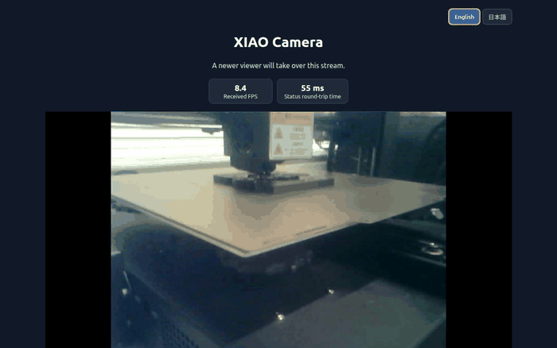

# XIAO ESP32-S3 Tailscale Camera

**English** | [日本語](README.ja.md)

Camera firmware for the Seeed XIAO ESP32-S3 Sense. Docker is used for setup and flashing. After flashing, the ESP32 runs on its own, so you do not need to keep a PC or Docker running to view the camera.

## Features

- Live video in a browser at up to 10 FPS
- The newest viewer takes over the single active stream
- Automatic exposure, gain, and white balance
- Remote access through Tailscale
- Live received FPS and status round-trip time

In low light, the camera raises exposure, which can add image noise and blur moving objects. Add lighting if the area is completely dark.

## Requirements

- Seeed XIAO ESP32-S3 Sense with camera and a USB data cable
- 2.4 GHz Wi-Fi
- A Linux PC with Docker and Docker Compose
- A Tailscale account

## Initial setup

1. Clone this repository:

   \`\`\`sh
   git clone https://github.com/HidemitsuNishioka/xiao-esp32s3-tailscale-camera.git
   cd xiao-esp32s3-tailscale-camera
   \`\`\`

2. Create local configuration files from the examples:

   \`\`\`sh
   cp .env.example .env
   cp secrets.yaml.example secrets.yaml
   \`\`\`

3. Open \`secrets.yaml\` in a text editor and replace the \`REPLACE_ME\` and \`YOUR_...\` values with your own settings:
   - \`wifi_ssid\` and \`wifi_password\`: your 2.4 GHz Wi-Fi credentials
   - \`tailscale_auth_key\`: create a key using the steps in [Tailscale key and IP address](#tailscale-key-and-ip-address)
   - \`api_encryption_key\`: run \`openssl rand -base64 32\` in a terminal and use the generated string
   - \`web_username\` and \`web_password\`: choose credentials for the ESPHome status page

   \`.env\` and \`secrets.yaml\` are excluded from Git. Never put real credentials in the README or source code.

4. Connect the XIAO over USB. From the project folder, validate the configuration and flash the firmware:

   \`\`\`sh
   docker compose run --rm esphome config xiao-esp32s3-tailscale-camera.yaml
   docker compose run --rm esphome run xiao-esp32s3-tailscale-camera.yaml --device /dev/ttyACM0
   \`\`\`

   ESPHome may leave its log view open after flashing. Once the logs show that Wi-Fi and Tailscale are connected, press \`Ctrl+C\` to close it. The firmware keeps running on the ESP32.

## Tailscale key and IP address

### Create an authentication key

1. Open the [Tailscale Admin Console Keys page](https://login.tailscale.com/admin/settings/keys).
2. Choose **Generate auth key**. For a single camera, turn **Reusable** off and leave **Ephemeral** off.
3. Paste the key into \`tailscale_auth_key\` in \`secrets.yaml\`. Treat it like a password. Do not commit it or include it in screenshots.
4. After flashing, the ESP32 joins your Tailnet over Wi-Fi. If your Tailnet requires approval for new devices, approve \`xiao-camera\` in the Admin Console.

For a camera that stays installed, the Tailscale node key may eventually expire and require re-authentication. If you need unattended operation, review [key expiry](https://tailscale.com/docs/features/access-control/key-expiry) and consider choosing **Disable Key Expiry** from the \`xiao-camera\` menu on the Machines page. Disabling expiry reduces re-authentication but increases the impact if the device is lost.

### Find the camera's IP address

You do not need to choose an IP address or enter the Wi-Fi router's \`192.168...\` address. Tailscale automatically assigns the camera a unique address, usually in the \`100.x.y.z\` range (Tailscale's range is \`100.64.0.0\`–\`100.127.255.255\`).

Find \`xiao-camera\` on the [Tailscale Admin Console Machines page](https://login.tailscale.com/admin/machines) and use the assigned IP. The address normally stays the same while the device remains registered in your Tailnet. See [Tailscale IP addresses](https://tailscale.com/docs/concepts/tailscale-ip-addresses) for details.

## View the camera

Install Tailscale on the phone or computer you will use to watch the camera, and connect it to the same Tailnet. Open this address in a browser, replacing the placeholder with the camera's assigned IP:

\`\`\`text
http://<CAMERA_TAILSCALE_IP>:8082/
\`\`\`

Use the **English** and **日本語** buttons in the top-right corner to switch languages.

**Received FPS** is the rate at which frames arrive in the browser. **Status round-trip time** measures a request and response between the browser and camera; it is not the one-way delay from image capture to display. Poor Wi-Fi or Tailnet connectivity can lower FPS and increase the round-trip time.

Only one viewer can watch at a time. A newer viewer takes over, and the previous viewer sees why its connection ended.

## Change Wi-Fi

Edit \`wifi_ssid\` and \`wifi_password\` in the local \`secrets.yaml\`, connect the XIAO over USB, and run the flashing command above again. Use a 2.4 GHz network.

## Troubleshooting

- **USB device not found:** Use a data-capable USB cable and set \`ESP32_DEVICE\` in \`.env\` to the device path on your PC. The default is \`/dev/ttyACM0\`.
- **Wi-Fi does not connect:** Confirm that the network is 2.4 GHz and check the SSID and password.
- **Video does not open:** Make sure the viewing device is connected to the same Tailnet and that you are using the camera's Tailscale IP.
- **Image is too dark:** Add lighting. Low light increases image noise and motion blur.

## Ports and access

- \`8082\`: Browser live video. Accepts connections from Tailscale IPv4 addresses.
- \`8081\`: Still image. It has no login. Do not expose this port to the public internet; use it only on a trusted network.
- \`80\`: ESPHome status page. Requires the username and password from \`secrets.yaml\`.

This project uses a community Tailscale external component; it is not an official Tailscale client.
